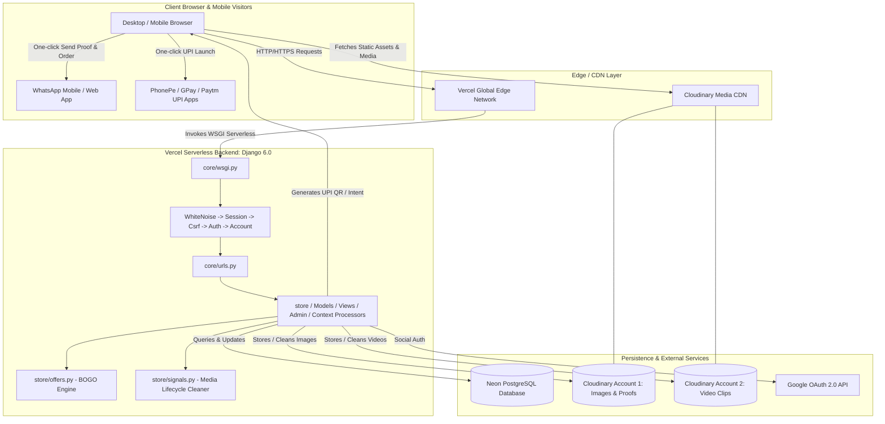
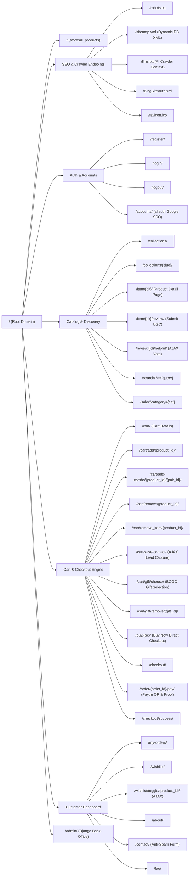
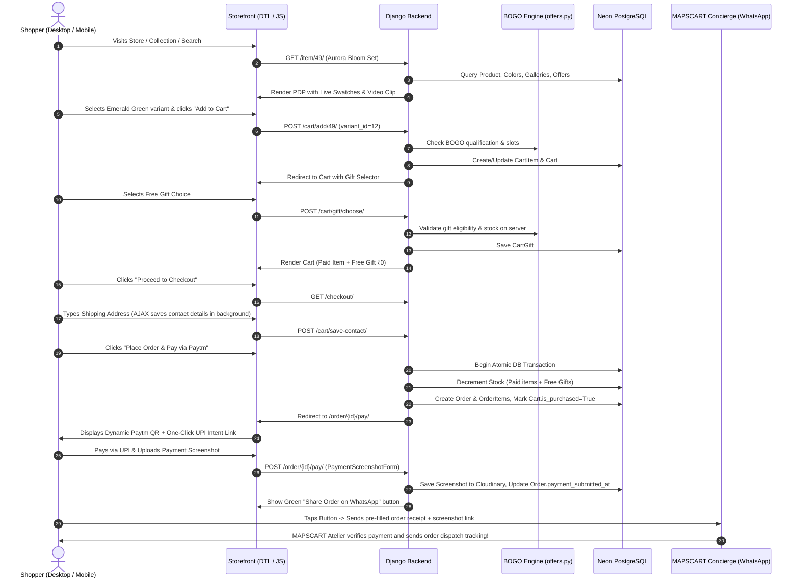
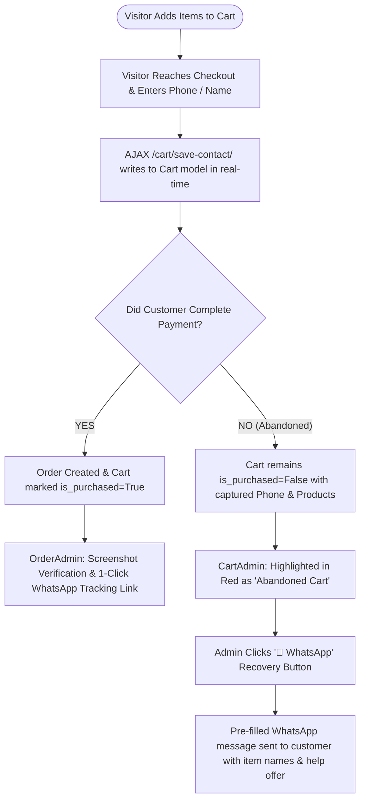
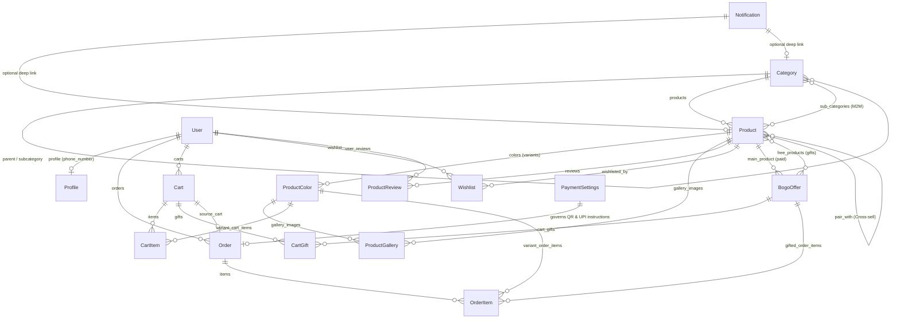

# MAPSCART (A Think Trend) — End-to-End Technical & Functional Documentation

> **Brand**: MAPSCART | A Think Trend  
> **Domain**: Luxury Handcrafted Indian Fashion Jewellery (Anti-tarnish, Hypoallergenic, Skin-safe)  
> **Headquarters**: Delhi, India  
> **Tech Stack**: Python 3.12+, Django 6.0+, Neon Serverless PostgreSQL, Cloudinary (Dual-Storage), Whitenoise, Vercel Serverless  
> **Version**: 2.0 (Production)  

---

## Table of Contents
1. [Executive Summary & System Architecture](#1-executive-summary--system-architecture)
2. [Full App Map & Architectural Visualizations](#2-full-app-map--architectural-visualizations)
   - [2.1 High-Level System Architecture](#21-high-level-system-architecture)
   - [2.2 Complete Route & Navigation Map](#22-complete-route--navigation-map)
   - [2.3 End-to-End Customer Purchase Journey](#23-end-to-end-customer-purchase-journey)
   - [2.4 Abandoned Cart & Vendor WhatsApp Fulfillment Loop](#24-abandoned-cart--vendor-whatsapp-fulfillment-loop)
   - [2.5 Entity-Relationship (ER) Schema Map](#25-entity-relationship-er-schema-map)
3. [Project File Structure & Directory Layout](#3-project-file-structure--directory-layout)
4. [Database Models & Data Schema Deep Dive](#4-database-models--data-schema-deep-dive)
5. [Step-by-Step Function & Feature Documentation](#5-step-by-step-function--feature-documentation)
   - [5.1 Core System Views & SEO (`core/urls.py`)](#51-core-system-views--seo-coreurlspy)
   - [5.2 Storefront & Catalog Discovery (`store/views.py`)](#52-storefront--catalog-discovery-storeviewspy)
   - [5.3 Product Details, Variants & UGC Reviews (`store/views.py`)](#53-product-details-variants--ugc-reviews-storeviewspy)
   - [5.4 Shopping Cart & Dynamic BOGO Engine (`store/views.py` & `store/offers.py`)](#54-shopping-cart--dynamic-bogo-engine-storeviewspy--storeofferspy)
   - [5.5 Checkout, Paytm QR & WhatsApp Concierge (`store/views.py`)](#55-checkout-paytm-qr--whatsapp-concierge-storeviewspy)
   - [5.6 Customer Authentication & Profiles (`store/views.py` & `store/forms.py`)](#56-customer-authentication--profiles-storeviewspy--storeformspy)
   - [5.7 Faceted Collections & Smart Categorization (`store/views.py`)](#57-faceted-collections--smart-categorization-storeviewspy)
   - [5.8 Static Informational Pages & Anti-Spam Contact Form (`store/views.py`)](#58-static-informational-pages--anti-spam-contact-form-storeviewspy)
   - [5.9 Wishlist & Social Engagement (`store/views.py`)](#59-wishlist--social-engagement-storeviewspy)
   - [5.10 Global Context Processors (`store/context_processors.py`)](#510-global-context-processors-storecontext_processorspy)
   - [5.11 Cloudinary Dual-Storage & Signal Automation (`store/storages.py` & `store/signals.py`)](#511-cloudinary-dual-storage--signal-automation-storestoragespy--storesignalspy)
   - [5.12 Admin Portal & CRM Superpowers (`store/admin.py`)](#512-admin-portal--crm-superpowers-storeadminpy)
   - [5.13 Scheduled CLI Management Commands (`store/management/commands/`)](#513-scheduled-cli-management-commands-storemanagementcommands)
6. [Security, Performance & Deployment Guide](#6-security-performance--deployment-guide)

---

## 1. Executive Summary & System Architecture

MAPSCART is a high-performance, full-stack e-commerce web platform engineered specifically for luxury jewellery retail. It features real-time variant switching, high-conversion Buy-One-Get-One (BOGO) automated bundling, UPI / Paytm QR seamless payments with zero gateway merchant transaction fees, automated WhatsApp concierge workflows, abandoned cart recovery CRM tools, and Cloudinary media optimization with automatic lifecycle garbage collection.

### Tech Stack Highlights:
- **Backend Framework**: Django 6.0.7 (Python 3.12/3.13 compatible).
- **Hosting / Compute**: Vercel Serverless Functions (`@vercel/python` with WSGI wrapper).
- **Primary Database**: Neon PostgreSQL with SSL connection pooling (`dj-database-url`).
- **Media Asset Infrastructure**:
  - Primary Cloudinary Account (`dddvvn0s`): Product imagery, colour swatch pictures, user-generated review photos, Paytm QR codes, payment receipts.
  - Secondary Cloudinary Account (`xcqh7rih`): Product video showcase clips via custom storage handler `VideoCloudinaryStorage`.
- **Static Assets**: Whitenoise 6.11.0 with cache-busting manifest.
- **Authentication**: Native Django Auth coupled with `django-allauth` for Google OAuth SSO.
- **Admin Dashboard**: Customized Django Admin with double-submit prevention, inline variant builders, color picker swatches, and automated WhatsApp chat links.

---

## 2. Full App Map & Architectural Visualizations

### 2.1 High-Level System Architecture



---

### 2.2 Complete Route & Navigation Map



---

### 2.3 End-to-End Customer Purchase Journey



---

### 2.4 Abandoned Cart & Vendor WhatsApp Fulfillment Loop



---

### 2.5 Entity-Relationship (ER) Schema Map



---

## 3. Project File Structure & Directory Layout

```
d:\store\
│
├── core/                                # Project Configuration & Root Routing
│   ├── __init__.py
│   ├── asgi.py                          # ASGI interface for async deployment
│   ├── wsgi.py                          # WSGI interface used by Vercel serverless
│   ├── settings.py                      # Global Django configuration, Cloudinary, DB, Allauth
│   └── urls.py                          # Root routing, robots.txt, sitemap.xml, llms.txt
│
├── store/                               # Core Application
│   ├── __init__.py
│   ├── admin.py                         # Django Admin CRM, double-submit protection, WhatsApp links
│   ├── apps.py                          # App registry & signal connection
│   ├── check_paytm.py                   # Self-healing diagnostic CLI tool for QR image integrity
│   ├── context_processors.py            # Global counts: cart badge, wishlist, notifications, nav categories
│   ├── forms.py                         # Custom registration form & phone sanitizer
│   ├── models.py                        # 15 Domain Models & DB Schema
│   ├── offers.py                        # Server-side BOGO discount & gift allocation engine
│   ├── remove_jazzmin.py                # Admin theme helper script
│   ├── signals.py                       # Automated Cloudinary orphan deletion & file replacement
│   ├── storages.py                      # Custom VideoCloudinaryStorage backend for secondary cloud
│   ├── tests.py                         # Error page tests (404/500 handlers)
│   ├── urls.py                          # 28 application routes
│   ├── views.py                         # 45 view functions, cart managers, checkout & AJAX endpoints
│   │
│   ├── management/                      # Custom Django Management Commands
│   │   ├── __init__.py
│   │   └── commands/
│   │       ├── __init__.py
│   │       ├── cleanup_carts.py         # Automated cleanup of stale guest carts (> 30 days)
│   │       └── cleanup_cloudinary_orphans.py # Cloudinary orphan scanner & garbage collector
│   │
│   ├── migrations/                      # 39 Database schema migration files
│   │   ├── 0001_initial.py ... 0039_alter_paymentsettings_payee_name_alter_product_brand.py
│   │
│   ├── static/                          # Static branding, images, QR codes, scripts
│   │   ├── 1.png                        # Favicon & Brand Mark
│   │   ├── logo.jpeg / logo.png         # Main logos
│   │   ├── new-logo.png / logo_navbar.png
│   │   ├── hero.png, bridal.png, care.png
│   │   ├── paytm.png                    # Default Paytm QR fallback
│   │   └── store/
│   │       └── js/
│   │           ├── admin_prevent_double_submit.js # Double-click safeguard for admin
│   │           └── qrcode.min.js        # Client-side dynamic QR generator
│   │
│   └── templates/                       # Storefront UI Templates
│       ├── 404.html
│       ├── admin/
│       │   ├── store/category/change_list.html
│       │   └── store/product/change_form.html # Variant drag-and-drop & color builder
│       └── store/
│           ├── index.html               # Main Homepage with hero, arrivals, trending & UGC
│           ├── product_detail.html      # Comprehensive PDP with live swatches & video
│           ├── cart.html                # Cart details & BOGO gift selection drawer
│           ├── checkout.html            # One-page checkout with real-time contact sync
│           ├── order_payment.html       # Paytm QR payment page & receipt upload
│           ├── checkout_success.html    # Confirmation screen
│           ├── collections.html         # Faceted catalog with occasion & finish filters
│           ├── collection_detail.html   # Category-specific view
│           ├── my_orders.html           # Customer dashboard with parcel tracking
│           ├── wishlist.html            # Saved customer items
│           ├── search.html              # Smart keyword & occasion-aware search
│           ├── sale.html                # Discounted & BOGO showcase
│           ├── about.html               # Brand history & atelier craftsmanship
│           ├── contact.html             # Verified contact concierge with anti-spam
│           ├── faq.html                 # Shipping, packaging & care FAQ
│           ├── login.html / register.html
│           ├── error.html
│           └── includes/                # Modular UI partials
│               ├── header.html
│               ├── header_css.html
│               ├── product_card.html
│               ├── product_card_css.html
│               ├── product_card_js.html
│               ├── notification_bell.html
│               ├── floating_whatsapp.html
│               └── footer_payment_strip.html
│
├── templates/                           # Global Error Handlers (404.html, 500.html)
├── staticfiles/                         # Production static files generated by collectstatic
├── db.sqlite3                           # Local fallback SQLite database
├── manage.py                            # Django project management CLI
├── requirements.txt                     # Pinned Python package dependencies
├── vercel.json                          # Vercel deployment configuration
├── sitemap.xml                          # Static XML sitemap fallback
├── llms.txt                             # Markdown summary for AI agents and LLM crawlers
├── BingSiteAuth.xml                     # Bing Webmaster verification
└── env.example                          # Environment variable template
```

---

## 4. Database Models & Data Schema Deep Dive

The application defines 15 interconnected models in [store/models.py](file:///d:/store/store/models.py):

| Model | Table / Purpose | Key Fields | Key Computed Properties & Methods |
|---|---|---|---|
| `Category` | Hierarchical taxonomy (Root collections & sub-styles like Studs, Jhumkas). | `name`, `slug`, `parent` (FK self), `keywords`, `order`. | `__str__` returns `Parent → Child`. `keywords` enables automatic product tagging based on title keywords. |
| `Product` | Primary jewellery catalog item. | `category`, `sub_categories` (M2M), `title`, `sku`, `brand`, `product_type`, `description`, `mrp`, `price`, `image`, `video`, `stock`, `weight_grams`, `dimensions`, `closure_type`, `pair_with` (M2M self), `occasions`, `metal_finish`, `is_active`. | `in_stock`, `is_low_stock` (<=5), `discount_percent`, `discount_amount`, `secondary_image` (card hover preview), `packaging_text` (earrings get velvet box, necklaces get velvet pouch), `color_tags`, `style_tags`, `occasion_tags`, `metal_finish_tags`, `average_rating`, `review_count`. |
| `ProductColor` | Colour variants / SKU options for a product (e.g. Rose Gold, Emerald Green). | `product` (FK), `order`, `name`, `sku`, `price`, `mrp`, `special_offer_price`, `stock`, `hex_code`, `image`, `is_available`. | `in_stock`, `display_hex` (auto-resolves color names like sapphire, ruby to hex codes via `resolve_color_hex`), `effective_price`, `effective_mrp`, `all_images` (variant image + linked gallery photos). |
| `ProductGallery` | Secondary photos for zoom, carousels, and variant galleries. | `product` (FK), `color` (FK ProductColor, optional), `image`, `is_primary`, `order`. | Enables linking specific gallery photos to a chosen colour variant. |
| `BogoOffer` | Admin-managed Buy-1-Get-1 Free configuration. | `name`, `is_active`, `main_product` (FK Product), `free_products` (M2M Product), `free_per_main`, `max_free_per_order`, `start_date`, `end_date`. | `clean()` prevents overlapping active offers on the same product. `is_live()` verifies start/end timestamps and master switch. |
| `Cart` | Customer shopping basket & Abandoned Cart tracker. | `cart_id` (session UUID), `user` (FK User), `customer_name`, `customer_email`, `customer_phone`, `is_purchased`, `order` (FK Order), `date_added`, `updated_at`. | `total_items()`, `total_value()`, `product_summary()`. Tracks incomplete checkouts for admin WhatsApp recovery. |
| `CartItem` | Line item in a shopping cart. | `product` (FK), `cart` (FK), `variant` (FK ProductColor), `color_name`, `quantity`, `is_active`. | `unit_price`, `display_image`, `display_sku`, `effective_color_name`, `sub_total()`. |
| `CartGift` | Free gift chosen by customer under an active BOGO offer. | `cart` (FK), `offer` (FK BogoOffer), `product` (FK Product), `quantity`. | Always re-validated on the server on every cart action; price is ₹0. |
| `Order` | Finalized order record. | `user` (FK User), `full_name`, `email`, `mobile_number`, `shipping_address`, `city`, `postal_code`, `amount_paid`, `discount_amount`, `offers_applied` (JSON), `payment_method` (`PAYTM`), `is_paid`, `payment_screenshot`, `payment_submitted_at`, `status` (`PENDING`, `CONFIRMED`, `SHIPPED`, `DELIVERED`, `CANCELLED`), `tracking_number`, `date_ordered`. | `payment_status` (computes 'Awaiting payment', 'Payment under verification', 'Paid', 'Cancelled'). `restore_stock()` returns all items back into inventory if cancelled. |
| `OrderItem` | Immutable historical snapshot of purchased line items. | `order` (FK), `product` (FK, `PROTECT`), `variant` (FK ProductColor, `SET_NULL`), `sku`, `color`, `price`, `quantity`, `is_free_gift`, `bogo_offer` (FK BogoOffer). | Preserves exact SKU, color, and price at purchase moment even if catalog changes. |
| `ContactInquiry` | Customer concierge and inquiry logs. | `name`, `email`, `phone`, `subject`, `message`, `created_at`. | Captures verified inquiries after rigorous anti-spam and regex checks. |
| `Wishlist` | Saved customer products. | `user` (FK User), `product` (FK Product), `added_on`. | Unique constraint on `(user, product)`. |
| `PaymentSettings` | Singleton model for store Paytm QR and vendor contact details. | `paytm_qr` (ImageField), `payee_name`, `upi_id`, `vendor_whatsapp`, `extra_instructions`. | `shop_upi_id()` returns custom or default UPI ID (`maps536969@sbi`). `vendor_number()` returns recipient phone for order WhatsApp dispatches. |
| `Notification` | Store-wide banner announcements and bell drawer notifications. | `title`, `message`, `notification_type` (`restock`, `collection`, `sale`, `info`), `badge_text`, `product` (FK), `category` (FK), `link_url`, `link_text`, `is_active`, `show_in_announcement_bar`. | `get_target_url()` dynamically resolves target links. |
| `Profile` | User extension for mobile phone tracking. | `user` (OneToOne User), `phone_number`, `created_at`, `updated_at`. | Automatically created on registration to store 10-digit delivery mobile numbers. |
| `ProductReview` | Customer social proof, rating and photo UGC. | `product` (FK), `user` (FK User), `name`, `email`, `rating` (1-5), `headline`, `review_text`, `outfit_tag`, `image`, `image_url`, `is_verified`, `is_approved`, `helpful_count`. | Supports outfit tags (e.g. Saree, Lehenga, Western), photo previews, helpful votes. |

---

## 5. Step-by-Step Function & Feature Documentation

### 5.1 Core System Views & SEO (`core/urls.py`)

1. **`robots_txt(request)`**:
   - Generates dynamic `text/plain` crawling rules.
   - Allows `/`, `/llms.txt`, and indexes `/sitemap.xml`.
   - Protects private routes: `/admin/`, `/cart/`, `/checkout/`, `/order/`, `/accounts/`.

2. **`llms.txt(request)`**:
   - Serves the `llms.txt` standard file for AI crawlers, search LLMs, and conversational agents, highlighting brand values, anti-tarnish specs, collections, and policies in clean Markdown format.

3. **`sitemap_xml(request)`**:
   - Automatically builds an XML sitemap of all active products, categories, collections, and static landing pages.
   - Assigns priority weights: `1.0` for Home, `0.9` for Sale and Products, `0.8` for Collections.
   - Falls back gracefully to `sitemap.xml` file if DB connection is unavailable.

4. **`bing_site_auth(request)`**:
   - Serves `BingSiteAuth.xml` for automated Bing Webmaster Tools domain ownership verification.

---

### 5.2 Storefront & Catalog Discovery (`store/views.py`)

1. **`all_products(request)`**:
   - **Step 1**: Queries all active products using `select_related('category')` and prefetching `colors`, `sub_categories`, `gallery_images` to minimize DB queries.
   - **Step 2**: Segregates the 4 newest products into `recent_products` ("Latest Arrivals").
   - **Step 3**: Passes remaining items through `Paginator` (20 items per page).
   - **Step 4**: Attaches active BOGO offer badges via `attach_offers()`.
   - **Step 5**: Queries approved customer UGC reviews (`ugc_reviews`) for the social proof wall.
   - **Step 6**: Generates faceted filter data (colors, styles, price ranges) and wishlist state.
   - **Step 7**: Renders [store/index.html](file:///d:/store/store/templates/store/index.html).

2. **`home(request)`**:
   - Lightweight alternative landing view rendering `store/home.html` with latest 4 arrivals.

3. **`_trust_words(product, extra=3)`**:
   - Generates deterministic trust badges (`Best Quality`, `Quality Assurance`, `Best Price` + 3 seeded badges based on `product.pk` such as `Handpicked Design`, `Gift Ready`).

---

### 5.3 Product Details, Variants & UGC Reviews (`store/views.py`)

1. **`product_detail(request, pk)`**:
   - **Step 1**: Retrieves the product with `is_active=True` or returns a 404.
   - **Step 2**: Attaches live BOGO offer details and identifies available free gifts.
   - **Step 3**: Evaluates URL parameters `?variant=` or `?color=` to pre-select a specific colour variant; defaults to the first in-stock variant.
   - **Step 4**: Builds recommendation list (`suggested_products`): checks `pair_with` (Complete The Look combo pieces), then same category + matching color, then general category pieces.
   - **Step 5**: Computes comprehensive rating stats: average rating, star distributions (5★, 4★, 3★, 2★, 1★ percentages), verified UGC photo gallery.
   - **Step 6**: Renders [store/product_detail.html](file:///d:/store/store/templates/store/product_detail.html).

2. **`add_product_review(request, pk)`** (POST only):
   - Validates customer name, email, rating (clamped 1-5), review text, outfit styling tag, and optional uploaded photo.
   - Saves `ProductReview` with `is_verified=True` and `is_approved=True`.
   - Handles both AJAX submission (JSON response) and standard form redirects to `#customer-reviews`.

3. **`vote_review_helpful(request, review_id)`** (POST only):
   - Increments `helpful_count` on `ProductReview` using atomic `F('helpful_count') + 1`.
   - Sets session flag `voted_review_{id}` to prevent multiple votes from the same visitor session.

---

### 5.4 Shopping Cart & Dynamic BOGO Engine (`store/views.py` & `store/offers.py`)

1. **`_cart_id(request)`**:
   - Reads or initializes a unique visitor cart ID stored in Django session (`uuid.uuid4().hex`).

2. **`_sync_cart_user(request, cart)`**:
   - Links anonymous guest carts to the authenticated user upon login/registration.
   - Captures customer name, email, and mobile phone from past orders into the `Cart` record.

3. **`_get_cart(request, create=False)`**:
   - Retrieves the visitor's open cart (`is_purchased=False`) from session or user account, creating one if requested.

4. **`_stock_problems(cart_items)`**:
   - Inspects active stock levels for every item (and specific variant stock) in the cart.
   - Returns user-friendly warning messages if stock decreased or items sold out.

5. **`add_cart(request, product_id)`**:
   - **Step 1**: Retrieves product and checks overall stock.
   - **Step 2**: Evaluates requested `variant_id` or `selected_color`, verifying variant-level stock.
   - **Step 3**: Finds or creates `CartItem` matching the specific variant.
   - **Step 4**: Increments quantity if within available inventory limits.
   - **Step 5**: Calls `_handle_gift_after_add()`: if the product qualifies for a BOGO offer, automatically attaches single gifts or prompts gift selection.
   - **Step 6**: Returns JSON response for AJAX additions or redirects to `/cart/#gifts`.

6. **`add_combo_cart(request, product_id, pair_id)`**:
   - One-click "Complete The Look" handler: adds both the primary jewellery piece and its curated pairing piece into the cart in a single step.

7. **`_priced_cart(cart, request=None)`**:
   - Core pricing calculator: calls `sync_gifts(cart)` to strip expired or unqualified gifts, attaches variant prices, and calculates subtotal, gift discounts, and net total.

8. **`cart_detail(request)`**:
   - Prepares cart context: line items, applied BOGO offers, free gifts chosen, savings amount, and stock problem warnings. Renders [store/cart.html](file:///d:/store/store/templates/store/cart.html).

9. **`choose_gift(request)`** (POST only):
   - Handles customer gift selection for BOGO offers.
   - **Server-Side Security**: Verifies that the main product is in the cart, the offer is active, the gift is in the authorized `free_products` list, and stock is available before creating `CartGift`.

10. **`remove_gift(request, gift_id)`** & **`remove_cart(request, product_id)`** & **`remove_cart_item(request, product_id)`**:
    - Decrements quantity or deletes line items/gifts from the cart.

11. **`buy_now(request, pk)`** (POST only):
    - Fast-track checkout: adds the selected product variant to the cart, evaluates BOGO gifts, and immediately redirects the user to `/checkout/`.

12. **`save_cart_contact(request)`** (POST only):
    - Real-time AJAX endpoint triggered on blur/input during checkout.
    - Persists customer full name, email, and mobile phone to the `Cart` model immediately, enabling abandoned cart recovery even if the user drops off before placing the order.

---

### 5.5 Checkout, Paytm QR & WhatsApp Concierge (`store/views.py`)

1. **`checkout(request)`** (`@login_required`):
   - **GET**: Verifies cart has active items, recalculates offers, warns of any stock changes, pre-fills delivery details from customer profile or cart, and renders [store/checkout.html](file:///d:/store/store/templates/store/checkout.html).
   - **POST**:
     - **Validation**: Ensures name, email, 10-digit mobile phone, shipping address, city, postal code are present.
     - **Price Lock Check**: Compares `expected_total` from the client with server-computed total to prevent price discrepancies.
     - **Atomic Transaction**: Enters `transaction.atomic()`:
       - Creates `Order` with delivery details, total amount, and discount JSON snapshot.
       - Iterates over cart items: decrements variant or product stock using atomic `F('stock') - item.quantity` with safety checks (`stock__gte=quantity`). Creates `OrderItem`.
       - Iterates over free gifts: decrements gift stock, creates `OrderItem` with `price=0` and `is_free_gift=True`.
     - **Cart Finalization**: Marks `cart.is_purchased=True`, associates `cart.order = order`, deactivates cart items, and redirects to `/order/{order_id}/pay/`.

2. **`order_payment(request, order_id)`** (`@login_required`):
   - Retrieves order and store `PaymentSettings`.
   - Generates standard UPI Intent string (`upi://pay?pa=...&pn=...&am=...&cu=INR&tn=Order_{id}`) for one-tap payments on mobile UPI apps (Paytm, PhonePe, GPay).
   - Displays merchant Paytm QR code.
   - **`PaymentScreenshotForm`**: Validates uploaded payment confirmation screenshot (clamped to 4MB max for Vercel payload safety).
   - On upload: updates `order.payment_screenshot` and `order.payment_submitted_at`.
   - Generates pre-formatted `_whatsapp_link()`. Renders [store/order_payment.html](file:///d:/store/store/templates/store/order_payment.html).

3. **`_whatsapp_link(request, order, settings_obj=None)`**:
   - Generates a `https://wa.me/{vendor_whatsapp}` URL pre-populated with:
     - Order ID, Customer Name, Phone, Shipping Address.
     - Itemized product list with SKU, chosen colour variant, and quantities.
     - Free gift breakdown.
     - Total amount paid and direct URL to the uploaded payment screenshot.

4. **`checkout_success(request)`**:
   - Displays confirmation screen for the recent order.

5. **`my_orders(request)`** (`@login_required`):
   - Customer account dashboard displaying past orders, line items, payment status badges, and parcel tracking numbers. Renders [store/my_orders.html](file:///d:/store/store/templates/store/my_orders.html).

---

### 5.6 Customer Authentication & Profiles (`store/views.py` & `store/forms.py`)

1. **`CustomRegistrationForm`**:
   - Subclasses Django's `UserCreationForm`.
   - Collects Username, Email, and 10-digit Mobile Number.
   - Sanitizes phone numbers: strips non-digits, strips `+91` or leading `0`, validates exactly 10 digits.
   - Validates email uniqueness case-insensitively.
   - `save()` creates/updates `Profile` model with `phone_number`.

2. **`register_user(request)`**:
   - Handles form validation, user creation, auto-login (`ModelBackend`), and cart synchronization.

3. **`login_user(request)`**:
   - Authenticates credentials, logs in user, migrates guest cart to user account, and safely redirects to `next_url`.

4. **`logout_user(request)`**:
   - Logs out user and redirects to login screen.

---

### 5.7 Faceted Collections & Smart Categorization (`store/views.py`)

1. **Faceted Filter Utility Functions**:
   - `_get_collection_color_filters(products)`: Computes distinct colors present in catalog with swatch hex values and product counts.
   - `_get_collection_style_filters(category, products)`: Dynamically tallies subcategory items (e.g. Studs, Drops, Halos, Jhumke).
   - `_get_occasion_filters(products)`: Counts products matching Occasion facets (`wedding-bridal`, `daily-office`, `cocktail-party`, `haldi-mehendi`).
   - `_get_metal_finish_filters(products)`: Counts products by finish (`anti-tarnish-gold`, `crystal-zircon`, `oxidised-silver`).
   - `_get_price_ranges(products)`: Categorizes items into `under_999`, `mid_999_1999`, `above_2000`.

2. **`collections(request)`**:
   - Catalog index supporting faceted URL queries (`?cat=`, `?sub=`, `?occasion=`, `?finish=`, `?price=`).
   - Maps occasion aliases (`bridal`, `wedding`, `sangeet`, `haldi`) to core facets.
   - Renders [store/collections.html](file:///d:/store/store/templates/store/collections.html).

3. **`collection_detail(request, slug)`**:
   - Category-specific view (e.g. `/collections/earrings/`, `/collections/necklaces/`).
   - Supports sub-collection style tabs and client-side instant swatch previews. Renders [store/collection_detail.html](file:///d:/store/store/templates/store/collection_detail.html).

4. **`search_products(request)`**:
   - Intelligent keyword and occasion-aware search (`?q=`).
   - Detects occasion intent in query:
     - "haldi" -> expands search to gold, yellow, jhumkas, chandbalis.
     - "mehendi" -> expands to green, emerald, verdant.
     - "bridal" / "dulhan" -> expands to bridal sets, chokers, maang tikka.
     - "reception" -> expands to tiaras, solitaires, tennis bracelets.
   - Renders [store/search.html](file:///d:/store/store/templates/store/search.html).

5. **`sale_products(request)`**:
   - Filters products where `mrp > price` (discounted) or active BOGO items. Renders [store/sale.html](file:///d:/store/store/templates/store/sale.html).

---

### 5.8 Static Informational Pages & Anti-Spam Contact Form (`store/views.py`)

1. **`about(request)`**:
   - Atelier craftsmanship, Delhi roots, anti-tarnish plating process. Renders [store/about.html](file:///d:/store/store/templates/store/about.html).

2. **`faq(request)`**:
   - Common customer questions regarding hypoallergenic testing, velvet packaging, and care guides. Renders [store/faq.html](file:///d:/store/store/templates/store/faq.html).

3. **`_validate_contact_inquiry(name, email, phone, subject, message)`**:
   - **Deep Anti-Junk Validation**:
     - **Name**: Must be between 2 and 60 chars, alphabetic only, no repeated junk characters (`aaaaa`).
     - **Email**: Strict regex with valid TLD, rejects fake/disposable domains (`xxxxx`, `mailinator`, `tempmail`).
     - **Mobile Number**: Indian mobile numbers must be 10 digits starting with 6, 7, 8, or 9; rejects repetitive dummy numbers (`9999999999`, `9876543210`). Accepts valid E.164 international numbers.
     - **Subject & Message**: Length and character diversity checks.

4. **`contact(request)`**:
   - Includes hidden anti-bot honeypot field (`website`).
   - Enforces 10-second per-session submission cooldown against automated spam.
   - Persists verified entries to `ContactInquiry`. Renders [store/contact.html](file:///d:/store/store/templates/store/contact.html).

---

### 5.9 Wishlist & Social Engagement (`store/views.py`)

1. **`wishlist(request)`** (`@login_required`):
   - Shows all saved items for the logged-in customer. Renders [store/wishlist.html](file:///d:/store/store/templates/store/wishlist.html).

2. **`toggle_wishlist(request, product_id)`** (AJAX POST):
   - Toggles wishlist state using `Wishlist.objects.get_or_create()`.
   - Returns JSON `{'status': 'added'}` or `{'status': 'removed'}`.
   - Updates heart icon visuals and header badge count without page reload.

---

### 5.10 Global Context Processors (`store/context_processors.py`)

Configured in `settings.py` to run on every non-admin request:
1. `cart_count`: Total item count in the visitor's active cart.
2. `user_wishlist`: List of product IDs favorited by the logged-in user.
3. `store_notifications`: Up to 10 active `Notification` objects.
4. `store_notifications_count`: Total active notifications for the bell badge.
5. `store_announcements`: Notifications flagged with `show_in_announcement_bar=True`.
6. `nav_categories`: Root categories with prefetched subcategories for header navigation.
7. `wedding_occasions`: Curated wedding occasion specs (Haldi, Mehendi, Sangeet, Bridal, Reception) with icons, accent colors, and background styling.

---

### 5.11 Cloudinary Dual-Storage & Signal Automation (`store/storages.py` & `store/signals.py`)

1. **`VideoCloudinaryStorage` (`store/storages.py`)**:
   - Custom Django `Storage` implementation targeting Cloudinary resource type `video`.
   - Connects to dedicated secondary Cloudinary credentials (`xcqh7rih`).
   - Supports large video uploads via `upload_large()`, URL generation with caching, and invalidation on delete.

2. **`safe_delete_file(file_field, exclude_instance=None)` (`store/signals.py`)**:
   - **Zero-Dangling File Guarantee**: Safely deletes media assets from Cloudinary when an entity is deleted or updated.
   - **Reference-Counting Protection**: Before calling `storage.delete()`, checks all tables (`Product.image`, `Product.video`, `ProductColor.image`, `ProductGallery.image`, `ProductReview.image`) to verify no other database record references the same file.

3. **Signal Receivers**:
   - `pre_delete(Product)`: Deletes main product image, gallery images, color variant images, and product video.
   - `pre_save(Product)`: Detects replaced image or video and deletes old file.
   - `pre_delete(ProductColor)` & `pre_save(ProductColor)`: Cleans variant swatches and linked gallery pictures.
   - `post_delete(ProductGallery)` & `pre_save(ProductGallery)`: Cleans removed gallery images.
   - `post_delete(ProductReview)`: Cleans deleted customer UGC photos.

---

### 5.12 Admin Portal & CRM Superpowers (`store/admin.py`)

1. **`ProductAdmin`**:
   - Integrated with `admin_prevent_double_submit.js` to prevent double-clicks when saving products.
   - Custom change form template (`admin/store/product/change_form.html`) with interactive drag-and-drop variant organizer.
   - Inline video player preview (`video_player_preview`).
   - Direct shortcut link to create BOGO offers for products.
   - Stock status indicators: Green (In Stock), Orange (Low Stock <=5), Red (Out of Stock).
   - Editable list view: adjust price, MRP, stock, and active status straight from table.

2. **`OrderAdmin`**:
   - `PaymentStatusFilter`: Quick sidebar filter to isolate orders needing screenshot verification (`Screenshot uploaded - CHECK NOW`).
   - One-click order actions: `mark_payment_verified`, `mark_confirmed`, `mark_shipped`, `mark_delivered`, `cancel_and_restore_stock`.
   - `cancel_and_restore_stock()` automatically restores inventory for all line items and free gifts in the order.
   - `whatsapp_customer_action`: Generates dynamic WhatsApp message button tailored to order status:
     - Status `SHIPPED` -> Pre-fills message with tracking number.
     - Status `is_paid` -> Pre-fills payment receipt confirmation.
     - Awaiting payment -> Pre-fills payment assistance reminder.

3. **`CartAdmin` (Abandoned Cart Recovery CRM)**:
   - Tracks visitors who added items to their cart.
   - `CartStatusFilter`: Filter by "Abandoned Cart (Has Items)", "Purchased", or "Empty".
   - Shows customer name, mobile number, and email captured via real-time checkout AJAX.
   - Preview of products in cart with thumbnail images.
   - `followup_actions`: **One-click "💬 WhatsApp" button** that generates a polite personalized WhatsApp message:
     *"Hi [Name], we noticed you were looking at [Product Names] on MAPSCART! We wanted to check if you had any questions..."*

4. **`CategoryAdmin`**:
   - Tree navigation preview with parent category linkages, display ordering, and keyword tagging.

5. **`BogoOfferAdmin`**:
   - Prevents overlapping active offers on the same main product.
   - Preview of live, scheduled, or expired badge status.

6. **`ProductReviewAdmin`**:
   - Moderation dashboard for customer reviews.
   - Toggles for `is_approved`, verified buyer badges, and photo previews.

7. **`PaymentSettingsAdmin`**:
   - Single-row configuration panel for Paytm QR code image, payee name, UPI ID, and vendor WhatsApp phone.

8. **`NotificationAdmin`**:
   - Broadcast manager for top announcement bar and notification bell drawer.

---

### 5.13 Scheduled CLI Management Commands (`store/management/commands/`)

1. **`cleanup_carts`**:
   - Deletes abandoned guest carts older than 30 days (`date_added__lt=cutoff_date`) to prevent database bloat.
   - Command: `python manage.py cleanup_carts`

2. **`cleanup_cloudinary_orphans`**:
   - Connects to Cloudinary Admin API, lists all uploaded resources under `media/images/`, and compares each against active database references across Products, Colors, Galleries, Reviews, Orders, and Settings.
   - Destroys unreferenced orphaned files from Cloudinary storage.
   - Supports dry-run auditing: `python manage.py cleanup_cloudinary_orphans --dry-run`

---

## 6. Security, Performance & Deployment Guide

### Security Architecture:
- **CSRF Protection**: All forms include ``; AJAX calls provide `X-CSRFToken` headers.
- **Strict Server-Side Offer Validation**: BOGO discounts and gifts are calculated entirely on the server. Client-submitted prices or gift parameters are never trusted.
- **Atomic Stock Management**: `transaction.atomic()` with `F('stock') - quantity` prevents race conditions during high-traffic drops.
- **Payload Clamping**: File upload sizes in `PaymentScreenshotForm` are restricted to under 4MB to prevent denial-of-service and Vercel payload rejection.
- **SQL Injection & XSS Defense**: Django ORM parameterized queries; form inputs sanitized with `strip_tags()` and strict regexes.

### Deployment on Vercel:
1. `vercel.json` routes all requests to `core/wsgi.py` via `@vercel/python`.
2. Static assets are collected into `staticfiles/` and served via Whitenoise.
3. Database connection pooling is managed via Neon's connection string with `conn_max_age=600` and `ssl_require=True`.

---
*Documentation compiled for MAPSCART (A Think Trend).*
